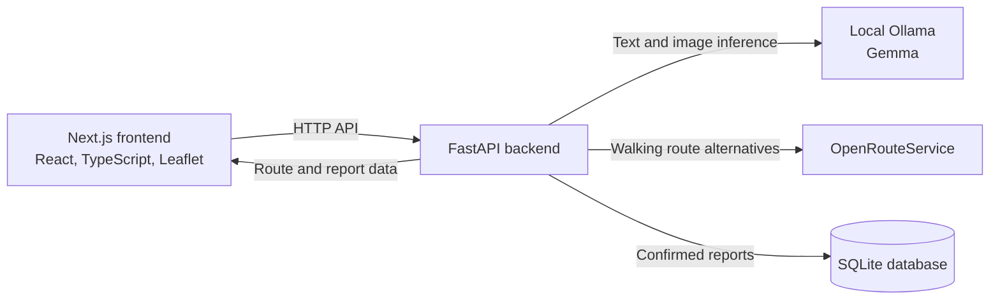

# AccessPath Go

**Go farther. Look at your phone less.**

AccessPath Go is an early-stage outdoor route companion for people who want to plan around mobility needs. Describe the walk that works for you, review route options and known community reports, then switch to **Touch Grass** mode and put your phone away.

## Contents

- [Why AccessPath Go?](#why-accesspath-go)
- [Features](#features)
- [Demo](#demo)
- [Architecture](#architecture)
- [Technology](#technology)
- [Run locally on Windows](#run-locally-on-windows)
- [API](#api)
- [Tests and quality checks](#tests-and-quality-checks)
- [Privacy and limitations](#privacy-and-limitations)
- [Contributing and license](#contributing-and-license)

## Why AccessPath Go?

The shortest walking route is not necessarily the most suitable route. Common routing data can provide a path, distance and estimated duration without establishing whether a route has stairs, steep slopes, rough surfaces or other access barriers. AccessPath Go makes those unknowns visible, lets people review mobility preferences and community reports, and avoids presenting a route score as proof of accessibility.

## Features

- Describe mobility needs in natural language and review or adjust the extracted preferences.
- Parse preferences with local Gemma through Ollama, with a deterministic fallback when text inference is unavailable.
- Request pedestrian route alternatives from OpenRouteService (ORS).
- Rank alternatives with a deterministic score based on target-duration fit and nearby community reports.
- Explore start, destination, route and report locations on an interactive Leaflet map. Keyboard coordinate entry is available alongside map clicks and browser geolocation.
- Analyze a barrier photo with Gemma, inspect the suggested category, severity, description and confidence, then confirm before sharing a report.
- View saved community reports and enter Touch Grass mode for a compact route summary.

## Demo

The [`demo/README.md`](demo/README.md) contains a Windows startup checklist and a walkthrough for demonstrating the current app. The repository does not currently include screenshots or a recorded video.

## Architecture



The backend validates model responses and route data. Route scoring is deterministic; an LLM does not choose or score routes.

## Technology

| Area | Technologies |
| --- | --- |
| Frontend | Next.js 15, React 19, TypeScript, Tailwind CSS, Leaflet, React Leaflet |
| Backend | Python 3.11+, FastAPI, Pydantic, Pydantic Settings, SQLModel, HTTPX |
| Local inference | Ollama with Gemma (default model: `gemma3:4b`) |
| Routing and map data | OpenRouteService walking API, OpenStreetMap tiles |
| Persistence | SQLite |

## Run locally on Windows

### Prerequisites

- Python 3.11 or later
- Node.js 20 or later and npm
- [Ollama](https://ollama.com/) for local AI features
- An [OpenRouteService API key](https://openrouteservice.org/dev/#/signup) for route requests

### Configure the backend

From the repository root, copy the provided environment file and add your ORS key:

```powershell
Copy-Item .env.example .env
notepad .env
```

Set `ORS_API_KEY` in `.env`. The file documents the current settings and defaults for `ORS_BASE_URL`, `OLLAMA_BASE_URL`, `OLLAMA_MODEL`, `DATABASE_URL`, and `FRONTEND_ORIGIN`. The backend also accepts `OLLAMA_TEXT_READ_TIMEOUT_SECONDS` (180 seconds by default) and `OLLAMA_IMAGE_READ_TIMEOUT_SECONDS` (600 seconds by default). Keep `.env` private and out of commits. The backend reads the root `.env` when launched from `backend/`.

In a PowerShell terminal:

```powershell
Set-Location backend
python -m venv .venv
.\.venv\Scripts\python.exe -m pip install -e ".[dev]"
.\.venv\Scripts\python.exe -m uvicorn app.main:app --reload
```

The API is available at `http://127.0.0.1:8000`; interactive API documentation is at `http://127.0.0.1:8000/docs`.

### Configure Ollama and Gemma

Install and start Ollama. Pull the configured vision-capable model:

```powershell
ollama pull gemma3:4b
```

The default `OLLAMA_BASE_URL` is `http://localhost:11434`, and `OLLAMA_MODEL` defaults to `gemma3:4b`. Change those names in the root `.env` if you use a different endpoint or model tag. If Ollama is not already running as a service, start it in a separate terminal with `ollama serve`.

### Start the frontend

In another PowerShell terminal:

```powershell
Set-Location frontend
npm.cmd install
npm.cmd run dev
```

Open `http://localhost:3000`. The frontend API URL defaults to `http://127.0.0.1:8000`; set `NEXT_PUBLIC_API_URL` if your backend uses another address. `npm.cmd` avoids PowerShell execution-policy issues with the `npm.ps1` shim.

## API

| Method | Endpoint | Behavior |
| --- | --- | --- |
| `GET` | `/health` | Returns API status and whether an Ollama endpoint/model is configured; it does not check inference availability. |
| `POST` | `/api/preferences` | Parses natural-language preferences with Ollama or uses the local fallback; returns preferences and explicit/suggested field metadata. |
| `POST` | `/api/routes` | Requests walking alternatives from ORS and returns route geometry, distance, duration, score, known nearby reports and accessibility notes. |
| `POST` | `/api/analyze-barrier` | Analyzes a JPEG, PNG or WebP upload (maximum 8 MB and 16 megapixels); returns validated barrier analysis or an error. |
| `POST` | `/api/reports` | Validates and stores a user-confirmed report in SQLite. |
| `GET` | `/api/reports` | Lists reports; optional bounding-box filtering uses `min_lon`, `min_lat`, `max_lon` and `max_lat` together. |

Coordinates for routes are `[longitude, latitude]`. Reports use separate `latitude` and `longitude` fields. The route score is lower-is-better: it combines target-duration deviation with severity penalties for non-`none` reports within about 30 metres of the route geometry. Current routing data does not establish stairs, slope or surface conditions, and those remain unknown.

## Tests and quality checks

Run from the `backend/` directory after installing the development dependencies:

```powershell
.\.venv\Scripts\python.exe -m pytest -q
.\.venv\Scripts\python.exe -m ruff check app tests
```

Build the frontend from `frontend/`:

```powershell
npm.cmd run build
```

## Privacy and limitations

- Preference and photo inference use the configured Ollama endpoint. By default it is local; changing `OLLAMA_BASE_URL` can direct prompts or photos to another host.
- Barrier images are checked and analyzed in memory and are not stored by the application. A finding is not saved as a community report until the user confirms it.
- Confirmed reports persist in the configured SQLite database with their coordinates, category, severity, description, confidence and creation time. The default database file is `data/accesspath.db` and is created when the backend starts. The app has no account system or report moderation workflow; reports may be inaccurate, misplaced or outdated.
- Route requests require internet access and a valid ORS key. Map tiles also load from OpenStreetMap over the network. Local Ollama inference does not make the application fully offline.
- The route score is a comparison aid based only on duration fit and nearby reports. It is not an accessibility, safety or route-condition guarantee. An absence of reports does not mean a route is barrier-free.
- The project does not provide turn-by-turn navigation or continuous location tracking.

## Contributing and license

Bug reports, accessibility feedback and focused pull requests are welcome. Please keep claims grounded in the data the app actually has, avoid committing API keys or identifying location/photo data, and run the backend checks and frontend build before opening a pull request.

This project is licensed under the [MIT License](LICENSE).
